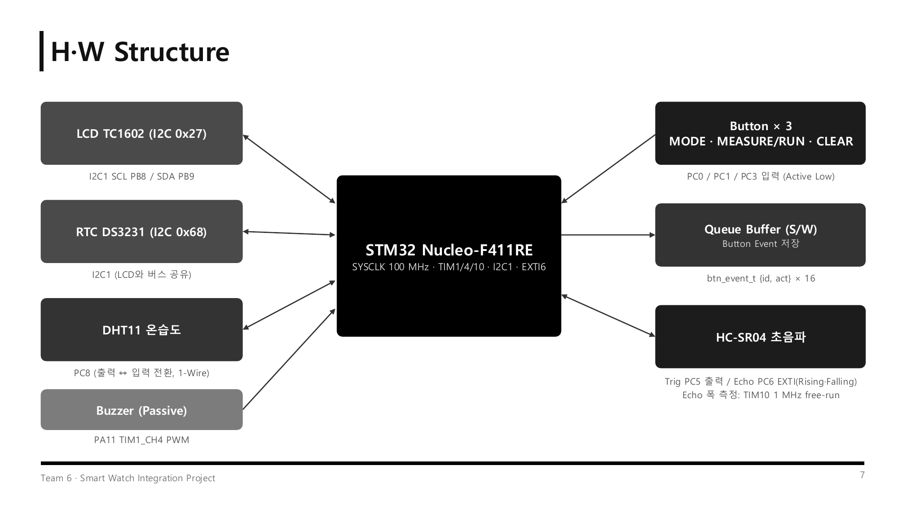
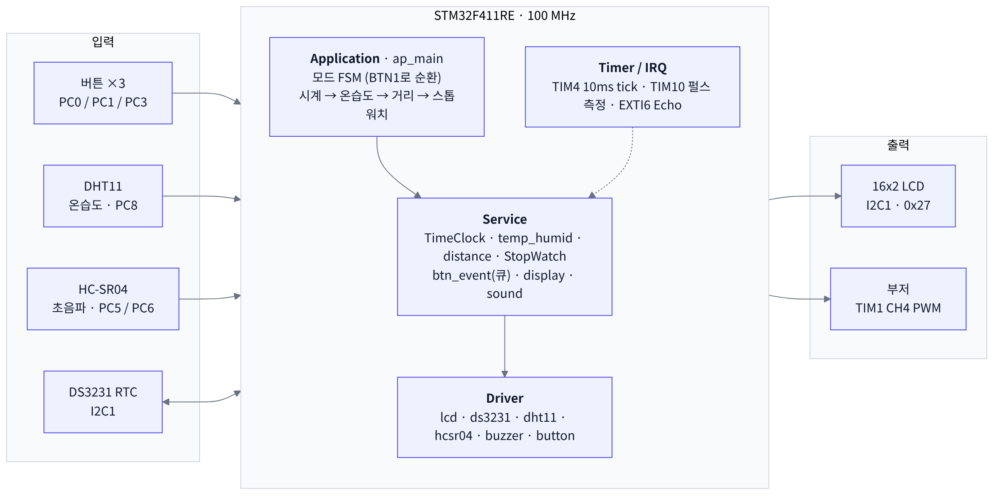
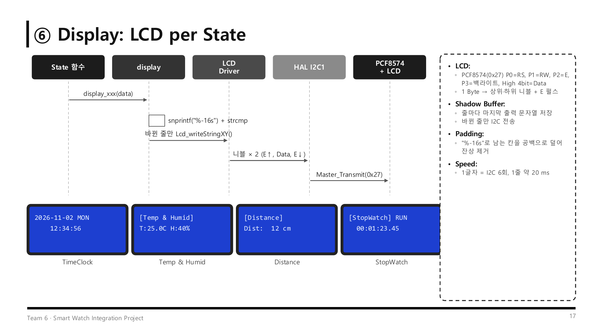
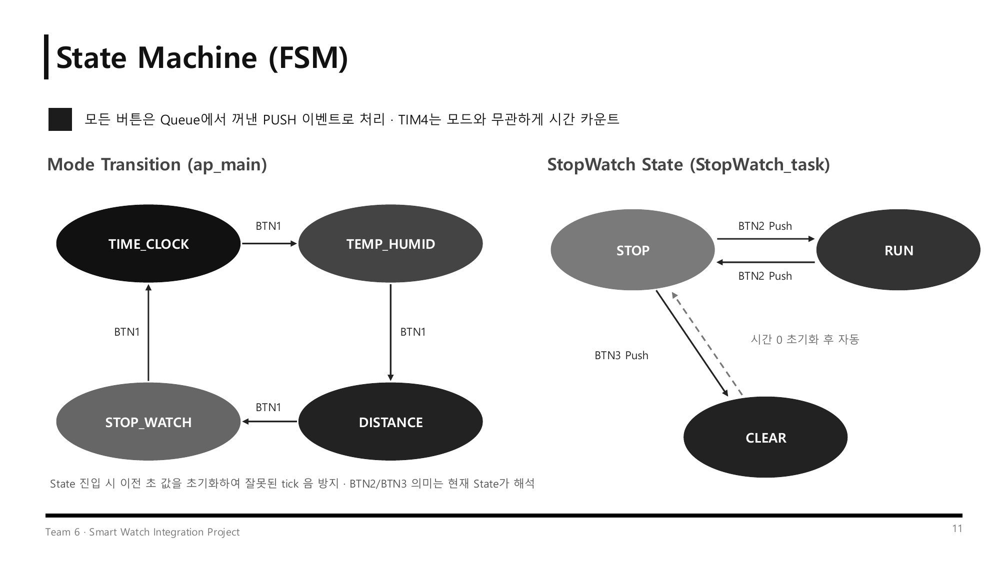
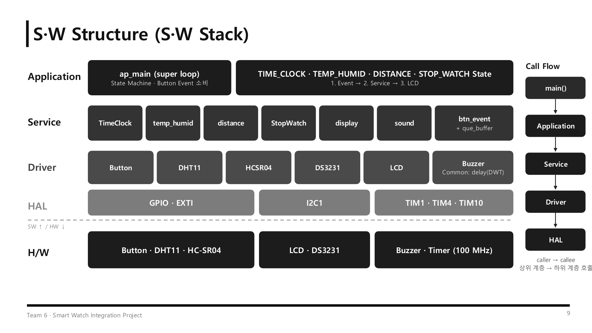

# STM32 Smart Watch Integration

STM32 Nucleo-F411RE 기반으로 **시계 · 온습도 · 초음파 거리 · 스톱워치** 4가지 기능을 하나의 FSM으로 통합한 스마트 워치입니다.
BTN1로 모드를 바꾸고, BTN2로 DHT11·HC-SR04를 원할 때 측정해 모든 정보를 16x2 LCD에 보여 줍니다. 버튼 입력은 Queue로 처리하고, 버튼음과 초 증가음은 부저로 냅니다.

> 📑 발표 자료: [docs/SmartWatch_Integration_Project.pdf](docs/SmartWatch_Integration_Project.pdf)

## System Overview



### System Flow

위 그림의 블록을 따라 데이터가 이렇게 흐릅니다.

1. **버튼 → Queue Buffer**
   버튼 3개(PC0/PC1/PC3)를 스캔해서 눌린 순간(PUSH)만 `btn_event_t {id, act}`로 만들어 링 버퍼 큐(최대 16개)에 넣습니다. 연타해도 입력을 놓치지 않습니다.
2. **Queue → 모드 FSM (STM32 super loop)**
   메인 루프가 한 바퀴에 이벤트 1개를 꺼내 버튼음을 내고, 현재 State 함수에 넘깁니다. BTN1은 다음 모드로 넘기고, BTN2·BTN3의 의미는 현재 State가 정합니다(측정 / RUN·STOP / CLEAR).
3. **시간 카운트 (TIM4 → RTC DS3231)**
   TIM4가 10ms마다 시계와 스톱워치를 카운트합니다. 소프트웨어 초가 바뀔 때만 I2C로 DS3231을 읽어 실제 시각에 맞춥니다.
4. **센서 측정 (DHT11 · HC-SR04)**
   측정 모드에서 BTN2를 누를 때만 1회 측정합니다. DHT11은 PC8 1-Wire로 약 25ms 블로킹 측정하고, HC-SR04는 Echo(PC6)의 상승·하강 엣지를 EXTI로 받아 TIM10 카운터 값을 저장하는 **논블로킹** 방식입니다.
5. **출력 (LCD · Buzzer)**
   State 함수가 결과를 `display`로 넘기면 바뀐 줄만 I2C LCD(0x27)에 다시 씁니다. 소리는 TIM1 PWM 부저로 내는데, 시작 시각만 기록하고 루프에서 끄는 논블로킹 방식이라 소리가 나는 동안에도 화면과 입력이 멈추지 않습니다.

> **설계 원칙**: ISR에서는 카운트 증가와 카운터 값 저장만 하고, I2C(LCD·RTC)처럼 느린 작업과 판단은 모두 super loop에서 처리합니다.



## 주요 기능

| 모드 | 동작 | LCD |
|---|---|---|
| **TimeClock** | DS3231에서 날짜·시각을 읽어 표시, 초가 바뀔 때마다 tick 음 | `2026-11-02 MON` / `12:34:56` |
| **Temp & Humid** | BTN2를 누를 때만 DHT11 1회 측정, 체크섬·타임아웃 오류 표시 | `T:25.0C H:40%` |
| **Distance** | BTN2를 누를 때만 HC-SR04 1회 측정 (EXTI 양쪽 엣지 + TIM10 1µs) | `Dist: 12 cm` / `Measuring...` / `No Echo` |
| **StopWatch** | RUN / STOP / CLEAR, 10ms 단위, RUN 중 초가 바뀔 때마다 tick 음 | `00:01:23.45` |

측정 전에는 `Press BTN2`를 표시합니다.



| 입출력 | 동작 |
|---|---|
| 버튼 | BTN1(PC0) 모드 전환 · BTN2(PC1) 측정 / RUN·STOP · BTN3(PC3) CLEAR → 모든 이벤트는 Queue 경유 |
| 부저 | 모든 버튼 0.1초 버튼음(C7) · 시계/스톱워치 초 증가 tick 음(G6, 30ms) · 부팅음 |

## 상태 머신



- **모드 전환**: BTN1을 누를 때마다 `TIME_CLOCK → TEMP_HUMID → DISTANCE → STOP_WATCH → TIME_CLOCK`
- **스톱워치**: BTN2로 `STOP ↔ RUN`, BTN3으로 0 초기화 후 `STOP`
- 상태에 들어갈 때 이전 초 값을 초기화해서 잘못된 tick 음이 나지 않게 했습니다.
- TIM4는 모드와 관계없이 계속 카운트하므로, 다른 모드에 있어도 시계와 스톱워치가 멈추지 않습니다.

## 구현 상세

### ① Button Event: Queue Buffer
- **Ring Buffer**: `head` = 넣을 칸, `tail` = 꺼낼 칸 · empty: `head == tail` · full: `next(head) == tail`
- **Generic Queue**: `elem_size` 단위 `memcpy`로 구조체를 그대로 저장
- **엣지 검출**: 눌린 순간(PUSH)만 큐에 넣고, 엣지 후 5ms 디바운스
- **1 Loop 1 Event**: 연타해도 순서대로 하나씩 처리

### ② TimeClock: RTC 읽기
- TIM4 ISR이 10ms마다 `msec++` 후 자리올림
- **소프트웨어 초가 바뀔 때만** `HAL_I2C_Mem_Read(0x68, 0x00~0x02)`로 RTC를 읽어 LCD와 공유하는 I2C 버스 부하를 줄임
- BCD → 10진 변환(`0x7F` 마스크 후 `bcd2bin()`), 날짜는 시가 바뀔 때만 다시 읽음

### ③ Temp & Humid: DHT11 요청 측정
- 2초 주기 측정 대신 **BTN2 이벤트 때 1회 측정**
- 시작 신호: PC8 출력 LOW 18ms → HIGH 후 입력으로 전환
- 비트 해석: DWT로 HIGH 폭 측정, 40µs 초과 = 1, 이하 = 0, 100µs 초과 시 타임아웃
- 체크섬(`byte0~3 합 == byte4`)이 맞을 때만 값 갱신, 약 25ms 블로킹(그동안 인터럽트는 계속 동작)

### ④ Distance: HC-SR04 + EXTI + TIM10
- Trigger: PC5를 10µs HIGH
- Echo 캡처: EXTI 상승 엣지 → `rise_cnt`, 하강 엣지 → `fall_cnt` (ISR에서는 카운터 값 저장만)
- **논블로킹**: 측정 중에도 super loop가 돌아 LCD에 `Measuring...` 표시
- 타임아웃: 상승 5ms / 하강 50ms 초과 → `No Echo`
- 거리: `cm = echo_us × 17 / 1000` (340m/s ÷ 2 = 0.017cm/µs), 16bit 카운터 wrap 1회 보정

### ⑤ StopWatch & Sound: 지연 없는 tick 음
- BTN2 → `SW_CMD_RUN_STOP`, BTN3 → `SW_CMD_CLEAR` (StopWatch는 버튼을 직접 읽지 않음)
- RUN일 때만 TIM4 ISR에서 `msec++`, 초가 바뀌면 G6 30ms tick 음
- `buzzer_on` 후 시작 시각만 기록하고 `sound_task()`가 시간이 지나면 끔, 버튼음 재생 중이면 tick은 무시

### ⑥ Display: State별 LCD
- PCF8574(0x27): P0=RS, P1=RW, P2=E, P3=백라이트, 상위 4bit=Data · 1바이트를 상위·하위 니블로 나눠 E 펄스와 함께 전송
- **Shadow Buffer**: 줄마다 마지막 출력 문자열을 저장하고 바뀐 줄만 I2C로 전송
- `"%-16s"` 패딩으로 남는 칸을 공백으로 덮어 잔상 제거 (1글자 = I2C 6회, 1줄 약 20ms)

## 트러블슈팅

### ① 거리 값이 갱신되지 않고 "측정 중"에서 멈춤

| | 2회차 이후 측정 | 반사체 없음 (타임아웃) | 결과 |
|---|---|---|---|
| Before | 이전 값 그대로 반환 | 무한 "측정 중" | 잘못된 거리 / 화면 멈춤 |
| **After** | 매번 새 Echo 결과 | 50ms 후 `No Echo` | BTN2마다 정상 갱신 |

- **현상**: 두 번째 측정부터 거리가 바뀌지 않고 이전 값이 그대로 표시됨. 앞에 반사체가 없으면 화면이 계속 "측정 중"에 멈춤
- **원인**: 첫 측정 후 `hcsr04_status`가 OK로 남아 있어서, 다음 요청 때 새 결과를 기다리지 않고 바로 OK를 반환함. 또 `HCSR04_getResult()`의 `NO_ECHO`(타임아웃) 결과를 무시해서 상태가 영원히 "진행 중"이었음
- **해결**: 측정을 요청할 때 status를 `IN_PROGRESS`로 초기화하고, `IN_PROGRESS`가 아닌 결과는 모두 반영해서 타임아웃은 `DISTANCE_ERROR`로 처리. LCD에 `Measuring...` / `No Echo`를 구분해 표시하고, 센서가 BUSY(Echo HIGH)일 때는 요청을 무시

### ② 블로킹 부저 때문에 화면이 멈춤

| | 버튼음 (100ms) | Tick 음 (30ms) | 결과 |
|---|---|---|---|
| Before | 100ms 동안 루프 정지 | 매초 루프 정지 | 화면·버튼 끊김 |
| **After** | 0ms (논블로킹) | 0ms (논블로킹) | 소리 중에도 화면·입력 정상 |

- **현상**: 버튼음과 초 tick 음이 나는 동안 LCD 갱신과 버튼 입력이 멈추고, 스톱워치 화면이 소리마다 끊겨 보임
- **원인**: 기존 `sound_button()`이 `HAL_Delay`로 100ms를 기다려 super loop 전체가 멈춤. 초마다 나는 tick 음까지 더해져 루프가 주기적으로 100ms 이상 정지
- **해결**: `sound_beep(freq, ms)`는 부저를 켜고 시작 시각만 기록하고, `sound_task()`가 매 루프 `HAL_GetTick()`으로 경과 시간을 확인해 끔. 버튼음이 재생 중이면 tick 음은 무시(우선순위)

## 하드웨어

### BOM

| 부품 | 모델 / 사양 | 수량 | 용도 / 인터페이스 |
|---|---|---|---|
| MCU 보드 | STM32 Nucleo-F411RE (Cortex-M4, 100 MHz) | 1 | 메인 제어 |
| RTC 모듈 | DS3231 | 1 | I2C1 (0x68), 시각/날짜 유지 |
| Character LCD | TC1602A 16x2 + PCF8574 | 1 | I2C1 (0x27), 모드별 화면 |
| 온습도 센서 | DHT11 | 1 | PC8 1-Wire |
| 초음파 센서 | HC-SR04 (5V, 2~400cm) | 1 | Trig PC5 / Echo PC6 (EXTI) |
| 부저 | Passive Buzzer | 1 | PA11 TIM1_CH4 PWM |
| Tact Switch | Push Button | 3 | MODE, MEASURE·RUN/STOP, CLEAR |

### Pin Map

| 기능 | 핀 | 설정 |
|---|---|---|
| I2C1 (LCD, RTC) | PB8(SCL) / PB9(SDA) | I2C 100 kHz |
| BTN1 MODE / BTN2 MEASURE·RUN / BTN3 CLEAR | PC0 / PC1 / PC3 | GPIO Input |
| DHT11 Data | PC8 | GPIO 출력 ↔ 입력 전환 |
| HC-SR04 Trig / Echo | PC5 / PC6 | GPIO Output / EXTI6 Rising·Falling |
| Buzzer | PA11 | TIM1_CH4 PWM |
| ST-LINK VCP | PA2 / PA3 | USART2 115200 bps |

### Timer & Interrupt

| 타이머 | 설정 | 역할 |
|---|---|---|
| TIM4 | PSC 1000-1, ARR 1000-1 → 10ms, IT ON | `TimeClock_ISR()`, `StopWatch_ISR()` 1/100초 카운트 |
| TIM10 | PSC 100-1, ARR 65535 → 1µs/count, IT OFF | Free-run 카운터, Echo 상승·하강 시점의 CNT로 펄스 폭 계산 |
| EXTI6 | PC6 Rising/Falling | `HAL_GPIO_EXTI_Callback()` → `distance_ISR()` |
| TIM1 | PSC 100-1 (1 MHz), CH4 | `ARR = 10⁶ / f − 1`, `CCR = (ARR+1) / 2` → Duty 50% 음 출력 |

## 소프트웨어 구조



```
Core/Src
├── ap/                      # Application
│   ├── ap_main.c            # 모드 FSM, 타이머/EXTI 콜백
│   ├── service/
│   │   ├── TimeClock/       # RTC 시간/날짜
│   │   ├── StopWatch/       # 스톱워치 (10ms tick)
│   │   ├── temp_humid/      # 온습도 측정
│   │   ├── distance/        # 초음파 거리 측정
│   │   ├── display/         # LCD 화면 구성 (Shadow Buffer)
│   │   ├── sound/           # 논블로킹 부저 효과음
│   │   └── btn_event/       # 버튼 이벤트 → 큐
│   └── common/              # delay(DWT µs), 링 버퍼 큐
└── driver/
    ├── lcd/  ds3231/  dht11/  hcsr04/  buzzer/  button/  led/  fnd/
```

## 결론 및 고찰

- 시계 · 온습도 · 초음파 · 스톱워치 4개 모드를 하나의 FSM으로 통합하고 LCD로 출력
- 버튼 입력을 Queue Buffer로 처리해 모든 버튼에 버튼음을 내고, 같은 이벤트를 모드별로 다르게 해석
- DHT11 · HC-SR04를 BTN2 요청 때만 측정 (DHT11은 블로킹, HC-SR04는 EXTI + TIM10 논블로킹)
- 개선할 점
  - RTC를 "소프트웨어 초가 바뀔 때"만 읽어 드물게 1초가 건너뛸 수 있음 → 100ms 주기 읽기로 개선 예정
  - DHT11 연속 측정 시 최소 1초 간격 필요 → 측정 간격 보호 로직 추가 예정
  - 센서 미연결에 대비해 PC6 Pull-down, 버튼 풀업 등 입력 핀 안정화 필요
  - DS3231 알람, 시간 설정 기능 추가

## 빌드 및 실행

1. STM32CubeIDE에서 `File → Import → Existing Projects into Workspace`로 이 폴더를 엽니다.
2. `Weekend_HW.ioc`로 핀 설정을 확인할 수 있습니다.
3. Build 후 NUCLEO-F411RE에 Debug/Run 합니다.

## 개발 환경

STM32CubeIDE, STM32 HAL (STM32F4xx), C
